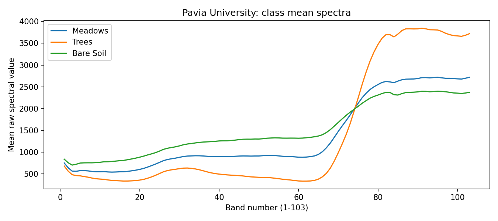
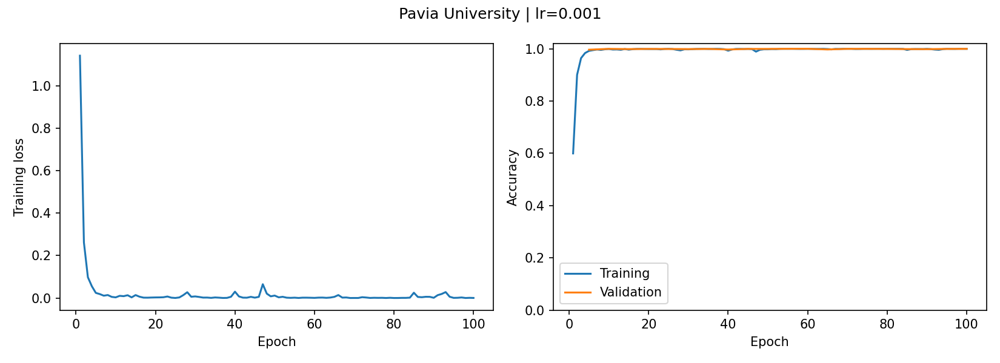
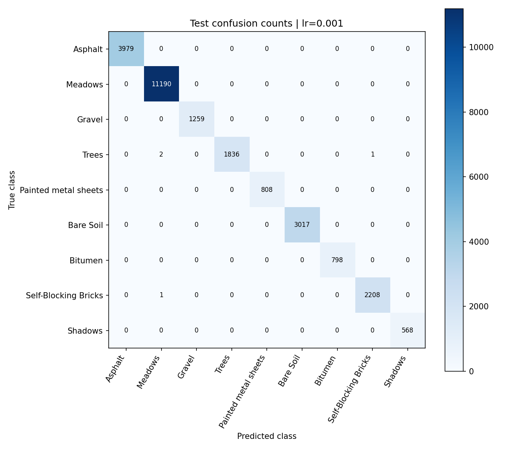

# 任务三：完整分类实验

[完整运行项目](实验项目/README.md) · [主模型指标](实验项目/results/runs/lr_0.001/results.json) · [逐类指标](实验项目/results/runs/lr_0.001/per_class.json) · [数据与划分协议](实验项目/results/protocol.json)

三类光谱CSV、完整history.json、预测、权重均保存在实验项目/results；完整100轮正式记录也保留。[返回入口](../README.md)。
