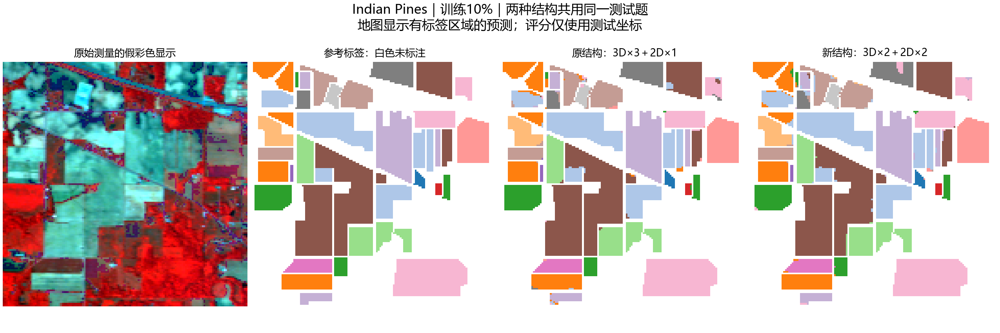
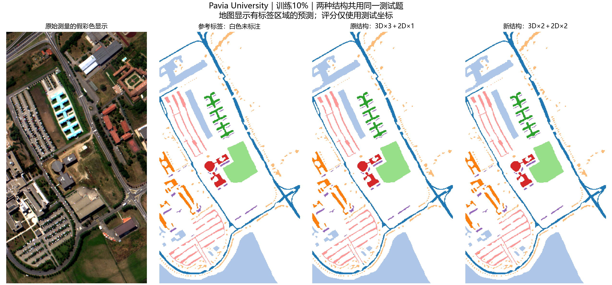
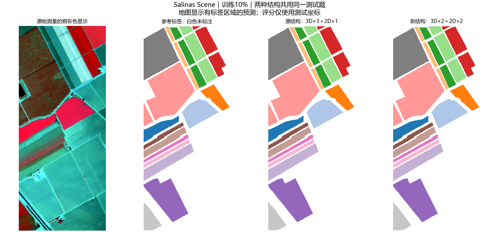

# 原结构3＋1与改动结构2＋2：精简提交

仅保留一个完整可运行对比脚本、结果表和可查看的图。IP/UP/SA三个数据集，各10%/30%训练比例，两种结构共12组，全部来自2026-10-05本机已保存实验，没有本次新训练。

- [单文件源码](HybridSN_2＋2_对比实验.py)：含论文3层3D＋1层2D基线和2层3D＋2层2D改动，可由architectures参数选择；模型、数据配置、训练与评价都合在一个文件中。
- [12组结果汇总](表格/12组结果汇总.csv)：OA/AA/Kappa、参数量、100轮及本机时间。
- [6组成对差异](表格/6组成对差异.csv)：同数据集、同训练比例内的两结构比较。
- [12组混淆矩阵计数](表格/12组混淆矩阵计数.csv)：合并为一张CSV，真实类与预测类编号/名称齐全。
- [配对分类图](配对分类图/)：6张原有配对图；[混淆矩阵](混淆矩阵/)和[训练曲线](训练曲线/)各12张，按数据集/比例/结构命名。
- [实测环境](环境记录.json)；依赖见[仓库requirements.txt](../../requirements.txt)。

## 已有结果

| 数据集 | 训练比例 | 结构 | OA % | AA % | Kappa |
|---|---:|---|---:|---:|---:|
| IP | 10% | 3d3_2d1 | 97.7317 | 96.4761 | 0.974147 |
| IP | 10% | 3d2_2d2 | 97.6829 | 97.2075 | 0.973581 |
| IP | 30% | 3d3_2d1 | 99.4797 | 98.0918 | 0.994065 |
| IP | 30% | 3d2_2d2 | 99.6748 | 99.5251 | 0.996292 |
| UP | 10% | 3d3_2d1 | 99.8627 | 99.7649 | 0.998180 |
| UP | 10% | 3d2_2d2 | 99.8919 | 99.8307 | 0.998567 |
| UP | 30% | 3d3_2d1 | 99.9026 | 99.6454 | 0.998709 |
| UP | 30% | 3d2_2d2 | 99.9727 | 99.9494 | 0.999639 |
| SA | 10% | 3d3_2d1 | 99.9931 | 99.9818 | 0.999923 |
| SA | 10% | 3d2_2d2 | 99.9838 | 99.9604 | 0.999820 |
| SA | 30% | 3d3_2d1 | 99.9846 | 99.9841 | 0.999829 |
| SA | 30% | 3d2_2d2 | 99.9908 | 99.9883 | 0.999897 |

## 查看6组成对图










## 运行方法

脚本是原实验流程的单文件发布副本：模型计算和训练超参数不改，仅合并源码、将数据改为相对data目录、将新结果默认写入“重新运行结果”、将最终汇总改为直接CSV输出。源码版本因此与历史训练原件不同，不能把它的文件哈希当作原实验源码摘要。

先按[data说明](data/README.md)放数据；本次未复制MAT、安装环境或重跑。原训练需CUDA，现有依赖版本见环境记录；其他机器未测试安装。

只检查参数：

```text
python "HybridSN_2＋2_对比实验.py" --help
```

只有主动执行下面命令才会训练：

```text
python "HybridSN_2＋2_对比实验.py" --architectures 3d2_2d2
```

默认三个数据集、10%/30%、100轮；若要从头复跑两结构，使用 --architectures 3d3_2d1 3d2_2d2。结果保存在新输出目录，不覆盖此处已保存的表格与图。

## 实验协议和限制

10%训练＋10%验证＋80%测试，或30%训练＋10%验证＋60%测试，按类分层seed666。每对共用同划分/PCA；不同结构全部初始化权重不要求逐位相同。IP的PCA30维、UP/SA15维，仅拟合训练中心、白化、full solver。Patch25×25，补0；Adam lr0.001、batch256、weight_decay1e-6、Dropout0.4，100轮、无翻转。每5轮验证，最高OA选模型、并列取最早；独立测试在选模后。

这是本机历史结果，不是论文表格原数值。不同训练比例测试集合不同，只在同条件内配对；单种子不能证明显著或普遍优越；随机patch可重叠，GT=0预测无准确性答案。原课程三学习率实验是另一批次，不能混作同一结构消融。

权重、完整断点、PCA/划分、原始预测、原源码快照和完整核查仍保留在原实验目录，精简上传副本不包含它们。它们不是本次代码＋对比图提交所必需的内容。

来源：[HybridSN论文DOI](https://doi.org/10.1109/LGRS.2019.2918719) · [官方代码](https://github.com/gokriznastic/HybridSN)；原许可说明在[仓库LICENSE-original.txt](../../LICENSE-original.txt)。

[返回任务五](../README.md) · [返回仓库](../../README.md)
